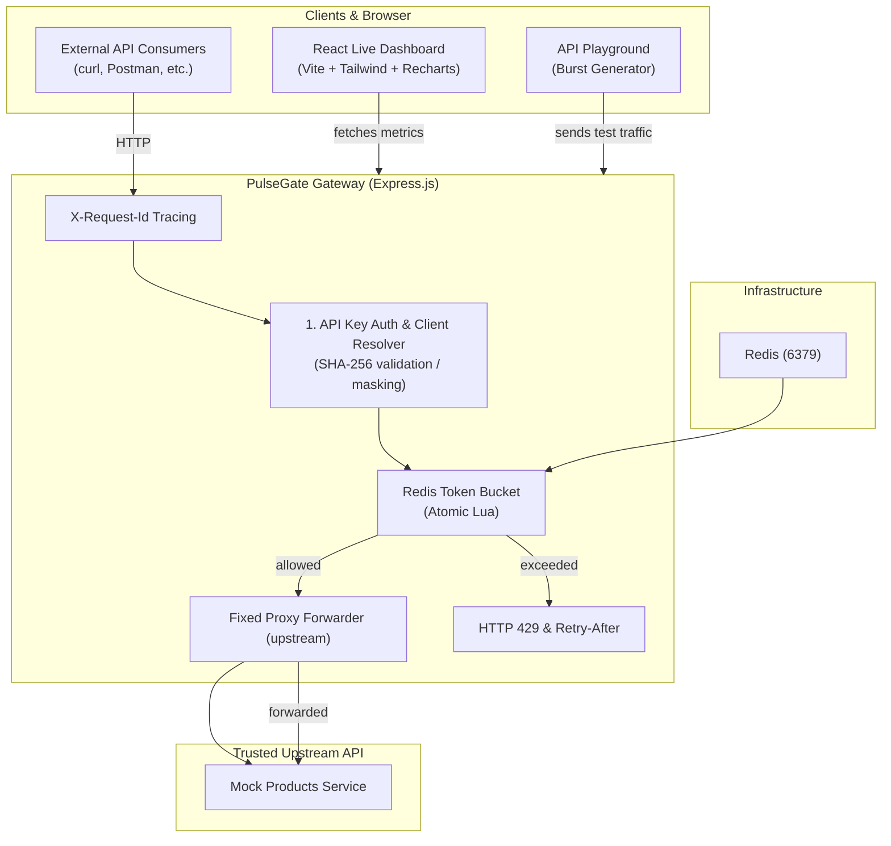
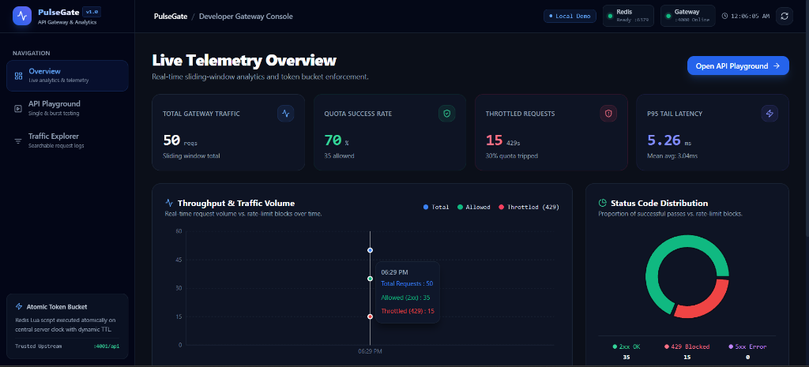
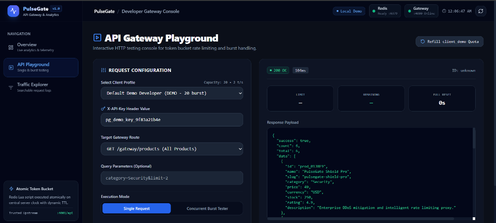
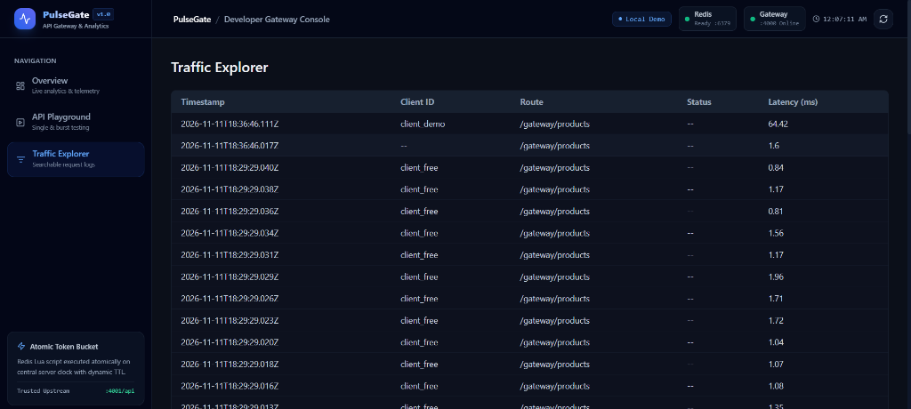

# PulseGate – API Gateway & Live Analytics

---

## 📖 Overview
PulseGate is a developer‑facing, high‑performance API Gateway with real‑time observability. It enforces per‑client and per‑route rate limiting using an **atomic Token Bucket algorithm** executed via Redis Lua scripting, protecting downstream services from bursts while streaming telemetry to an interactive React dashboard.

---

## 🎯 Problem Statement
Modern microservice architectures need a lightweight edge component that can:
- Prevent traffic spikes from overwhelming services.
- Provide fine‑grained, per‑client quota enforcement.
- Offer immediate visibility into request metrics, latency, and errors.
- Remain easy to run locally for development and testing.

PulseGate addresses these needs with a single Express gateway, a Redis‑backed rate limiter, and a Vite‑powered React analytics UI.

---

## ✨ Features
- **Token Bucket Rate Limiting** – atomic Redis Lua script ensures race‑free quota checks.
- **API‑Key Authentication** – SHA‑256 hashed keys, admin & demo keys.
- **Live Analytics Dashboard** – charts for request volume, latency, status codes.
- **Request Logging** – bounded in‑memory ring buffer (configurable).
- **Health & Metrics Endpoints** – Prometheus‑compatible metrics.
- **Docker Compose** – one‑command local development stack.
- **Comprehensive Test Suite** – unit, integration, concurrency, and failure‑scenario tests (Jest + Supertest).
- **Performance Test Suite** – k6 scripts for baseline, rate‑limited, burst, sustained, concurrent, and exhaustion scenarios.

---

## 🛠️ Technology Stack
| Layer | Technology |
|-------|------------|
| Gateway | Node.js (v20) + Express |
| Rate Limiter | Redis 7 (Lua scripting) |
| Upstream Mock | Express (simple product API) |
| Frontend | React 18 + Vite + Tailwind CSS + Recharts |
| Testing | Jest, Supertest |
| Performance | k6 (load‑testing) |
| Containerisation | Docker & Docker‑Compose |

---

## 🏗️ System Architecture

---

## 📦 Request Lifecycle
1. **Incoming request** hits `http://localhost:4000`.
2. **Request ID** (`X-Request-Id`) generated if absent.
3. **API‑Key middleware** validates the `x-api-key` header, resolves the client configuration.
4. **Rate‑Limiter** loads the client’s token bucket policy from Redis and runs the Lua script to atomically consume tokens.
5. If **tokens available** → request is proxied to the trusted upstream (`http://localhost:4001`).
6. If **tokens exhausted** → gateway responds with `429 Too Many Requests` and `Retry-After` header.
7. **Telemetry** (latency, status, client ID) is recorded and exposed on `/metrics` and via the UI.
---

## ⏳ Token Bucket Explanation
- Each client has a **capacity** (max tokens) and a **refill rate** (tokens per second).
- Tokens are stored in Redis as a hash `{clientId: {tokens, lastRefill}}`.
- The Lua script:
  1. Calculates elapsed time since `lastRefill`.
  2. Adds `elapsed * refillRate` tokens (capped at capacity).
  3. If `tokens >= 1` → decrement and allow request.
  4. Else → reject.
- This guarantees **single‑step atomicity**, eliminating race conditions across multiple gateway instances.
---

## 🗄️ Why Redis Lua Scripting?
- **Atomic execution**: read‑modify‑write in one step.
- **Performance**: script runs inside Redis, avoiding round‑trips.
- **Scalability**: works across distributed gateway instances without a lock service.
---

## 📂 Project Directory Structure
```
PulseGate/
├─ client/                 # React dashboard
│   ├─ src/                # UI components
│   ├─ public/             # static assets
│   └─ Dockerfile
├─ server/                 # Express gateway & upstream mock
│   ├─ src/
│   │   ├─ config/        # env, clients, policies, routes
│   │   ├─ middleware/    # apiKey, rateLimiter, requestId, errorHandler, telemetry
│   │   ├─ services/      # redis, tokenBucket, proxy, metrics, logger
│   │   ├─ controllers/   # gateway, analytics, logs
│   │   ├─ routes/        # health, gateway, metrics, admin, request logs
│   │   ├─ upstream/      # mock upstream service
│   │   └─ lua/            # token_bucket.lua
│   ├─ tests/              # Jest + Supertest suite
│   ├─ Dockerfile
│   └─ .env.example
├─ perf/                   # Performance testing suite (k6)
│   ├─ k6/                # scenario scripts
│   └─ helpers/           # env capture, policy override helper
├─ docker-compose.yml
├─ .dockerignore
├─ .env.example
└─ README.md               # this file
```
---

## 📋 Installation Prerequisites
- **Node.js** ≥ v18 (recommended v20)
- **Docker Desktop** (for the full stack) or a local **Redis** instance
- **npm** (comes with Node)
- **k6** (optional, for performance tests) – install via `choco install k6` (Windows) or `brew install k6` (macOS/Linux)
---

## ⚙️ Local Development Setup
```bash
# Clone repository (if not already)
git clone <repo-url>
cd PulseGate

# Copy environment templates
cp .env.example server/.env
cp client/.env.example client/.env

# Install server dependencies
cd server
npm install

# Install client dependencies
cd ../client
npm install
```
---

## 🐳 Docker‑Compose Setup
```bash
# Build and start all services (gateway, upstream, redis, frontend)
docker compose up --build -d

# Verify containers are running
docker compose ps
```
### Useful Docker commands
- `docker compose logs` – view logs for all services.
- `docker compose down` – stop containers.
- `docker compose down -v` – also remove volumes (clears Redis data).
---

## 📚 Backend API Documentation
| Method | Path | Description |
|--------|------|-------------|
| GET | `/health` | Health check – returns status of gateway, Redis, and upstream.
| GET | `/metrics` | Prometheus‑style metrics (request counts, latency histograms, token bucket state).
| POST | `/gateway` | Main entry point – forwards request to upstream after rate‑limit check.
| GET | `/analytics` | Returns aggregated analytics data for the dashboard.
| GET | `/logs` | Paginated request log view (protected, admin only).
---

## 🎮 API Playground Usage
The Playground UI (`http://localhost:5173/playground`) lets you:
- Select a client (demo API key pre‑loaded).
- Choose an HTTP method and path.
- Send custom headers / body.
- Observe response, status, headers (`X-RateLimit-Remaining`, `Retry‑After`).
---

## 📈 Analytics Dashboard Explanation
- **Traffic Overview** – total requests per minute, success vs rate‑limited.
- **Latency Chart** – P50, P95, P99 latency buckets.
- **Client Breakdown** – quota usage per client.
- **Error Summary** – 4xx/5xx counts.
- Data is fetched from `/metrics` and `/analytics` every 5 seconds.
---

## 📋 Example Requests
### Successful gateway request
```bash
curl -i -H "x-api-key: pg_demo_key_9f83a21b4e" \
     http://localhost:4000/gateway/products
```
_Response (200):
```json
{
  "products": [
    {"id":1,"name":"Product A"},
    {"id":2,"name":"Product B"}
  ]
}
```
---
### HTTP 429 response (rate limited)
```bash
curl -i -H "x-api-key: pg_demo_key_9f83a21b4e" \
     http://localhost:4000/gateway/products
```
_Response (429):
```
HTTP/1.1 429 Too Many Requests
Retry-After: 30
Content-Type: application/json

{"error":"Rate limit exceeded","requestId":"c1f2e3d4-..."}
```
---

## 🧪 Testing Commands
```bash
# Run full Jest suite (server only)
npm test --prefix server

# Run a single test file
npm test --prefix server -- tests/rateLimiter.test.js
```
All tests are executed with `--detectOpenHandles --runInBand` to surface async issues.
---

## 🔒 Security Considerations
- **API‑Key leakage** – keys are hashed before any logging; never stored in plaintext.
- **CORS** – only `CLIENT_ORIGIN` is allowed; all others are blocked.
- **SSRF protection** – upstream URL is fixed in config; gateway does not accept arbitrary target URLs.
- **Rate‑limit failure mode** – in Redis outage the gateway returns `503 Service Unavailable` (fail‑closed) rather than bypassing limits.
- **Error handling** – all uncaught errors funnel through a central error handler returning consistent JSON with a `requestId`.
---

## ⚠️ Known Limitations
- In‑memory request log has a configurable size (`REQUEST_LOG_LIMIT`). It is lost on process restart.
- The demo `overridePolicy.json` used for baseline performance tests is optional; without it the gateway always enforces rate limits.
- No TLS support out‑of‑the‑box – intended for local/dev environments.
- Upstream mock is static; real integrations require updating `UPSTREAM_BASE_URL`.
---

## 📸 Screenshots

### 1. Live Telemetry Overview
Real-time sliding-window analytics, token bucket quota enforcement, throughput charts, and p95 tail latency monitoring.


### 2. API Gateway Playground
Interactive HTTP testing console supporting single requests, client profile switching, and concurrent burst testing.


### 3. Traffic Explorer
Searchable and bounded in-memory request log with microsecond latency tracing and status code inspection.


---

## 🚀 Future Improvements
- **Persisted request logs** – e.g., write‑through to Redis or a DB.
- **Dynamic upstream routing** with secure allow‑list.
- **TLS termination** and configurable HTTPS.
- **Distributed tracing** integration (OpenTelemetry).
- **Horizontal scaling** – multiple gateway instances behind a load balancer.
- **Advanced analytics** – drill‑down per endpoint, error rates, client‑specific graphs.

---

## 👩‍💻 Developer
**Developer:** Sandhya Kushwaha